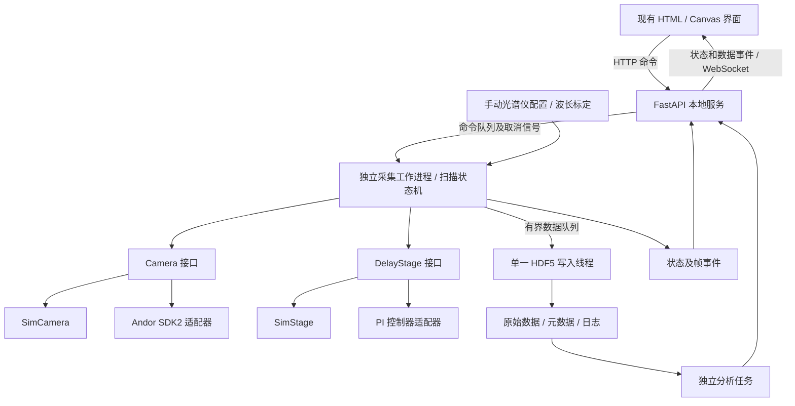

> 历史设计记录；当前状态以仓库 README 为准。

# Kerr Studio：Kerr 门 TRPL 后端方案

日期：2026-10-31。本文保留后端设计与分阶段目标；当前已实现模拟采集版本，实际功能、运行方法与未开放部分以 [README.md](README.md) 为准。尚未进行硬件联机测试。

## 1. 建议与已知条件

**建议采用 Python 本地后端 + FastAPI HTTP/WebSocket + 可替换设备驱动。保留现有 HTML/CSS/Canvas 界面，先把模拟设备接入完整采集、保存和分析流程，后续替换设备适配器。**

首版不引入数据库、云服务或前端框架重写。软件安装在控制仪器的 Windows 电脑上，服务默认只监听 `127.0.0.1`，同时提供静态前端和 API。

| 项目 | 当前结论 | 对设计的影响 |
|---|---|---|
| CCD | 用户指定 Andor Newton DU920P | 真实接口采用 Andor SDK2；运行时查询像素、读出和增益能力 |
| 延迟台 | 用户指定 PI M-414.32S，USB 连接 | 通过配套控制器连接；USB 不等于已确定控制器型号或协议 |
| 延迟光路 | 用户确认反射镜往返双程 | 默认光程倍率为 2，正负方向仍需实际标定 |
| 光谱仪 | 用户指定 Oriel model 77400 | 官方将其列为手动 MS125 光谱仪；按手动设置记录和波长标定管理，不假定有电动接口 |
| 当前设备状态 | 未连接仪器 | 默认启动模拟驱动；不要求安装厂商 DLL |
| 当前界面 | `index.html` 中的单页交互原型 | 保留视觉布局，替换前端生成数据及本地计时逻辑 |
| 本地资料 | 根目录 `Software Development Kit.pdf`，封面 Software Version 2.104 | 可用于 SDK2 接口设计；不代表电脑已安装此版本，也不代替当前相机能力查询 |

### 已核实的设备边界

- Newton DU920P 的常规规格为 1024 × 255 像素，部分深耗尽变体为 1024 × 256。前端目前的 2048 个合成像素需要改为后端能力返回值，垂直尺寸以 `GetDetector` 为准。Newton 官方快速入门明确使用 SDK2。[Andor 官方规格](https://andor.oxinst.jp/assets/uploads/products/andor/documents/Newton-940-Specifications.pdf)、[Newton 快速入门](https://andor.oxinst.com/downloads/uploads/Newton_EMCCD_and_CCD_Quick_Start_Guide.pdf)
- PI M-414.32S 是两相步进电机平台，标称行程 300 mm；官方数据表没有列出集成位置传感器。控制器返回的坐标必须标明来源，不能称为独立编码器实测位置。平台数据表不能确定用户现有控制器型号。[PI 数据表，2026-03-16，第 2–3 页](https://www.physikinstrumente.com/en/?downloadFileUid=1100&downloadUid=1229&type=5600)
- Oriel 77400 的官方波长选择方式为 Manual。因此首版的中心波长、光栅、狭缝是人工记录项；波长轴依赖适用于当前安装状态的标定，不能仅靠输入中心波长推导。[Newport 官方产品页](https://www.newport.com.cn/p/77400)

以上是资料事实。后文的技术选型、默认参数和软件行为是设计建议；模拟参数均不是仪器实测性能。

## 2. 总体结构



技术选择：

| 部分 | 建议 | 理由 |
|---|---|---|
| 运行环境 | Windows x64、Python 3.11 或经 SDK 验证的兼容版本 | 与厂商 DLL 位数一致；模拟和真实设备使用同一核心 |
| 本地服务 | FastAPI + Uvicorn，单实例、单 API worker | HTTP 提交命令，WebSocket 推送数据；避免多 worker 重复占用硬件 |
| 参数模型 | Pydantic | 严格校验单位、枚举、扫描点及能力约束 |
| 数值与分析 | NumPy、SciPy | 模拟、光谱提取、后续卷积拟合 |
| 数据文件 | h5py / HDF5；另附运行日志 JSONL | 原始数据、坐标、重复轮次和配置放在同一实验文件中 |
| PI 驱动 | 优先官方 PIPython + 对应 GCS DLL | 确认控制器后选用具体连接、回参考点及停止方法 |
| Andor 驱动 | 项目内 Camera 适配层优先使用 pylablib，底层依赖官方 SDK2 | 减少自行封装 ABI 与数据读取代码；必要时补充直接 SDK2 调用 |
| 测试 | pytest + API/WebSocket 集成测试 | 验证坐标、状态流、数据一致性及故障处理 |

FastAPI 原生支持 WebSocket；h5py 调用受内部全局锁保护，不应靠多个 HDF5 写线程提升吞吐。[FastAPI 文档](https://fastapi.tiangolo.com/advanced/websockets/)、[h5py 文档](https://docs.h5py.org/en/stable/threads.html)

设备 SDK 调用只在采集工作进程内串行执行，避免相机上下文和控制器访问竞争。文件只由写入线程操作。API 进程负责界面连接和命令入口，不直接访问仪器。Windows 使用 `spawn` 创建进程，厂商 DLL 在工作进程中按需加载。

模拟与真实模式必须显式选择并写入文件。真实连接失败时报告失败，**不得静默切换为模拟信号**。浏览器关闭或 WebSocket 断开不直接中止已接受的采集任务；重新打开时获取权威状态和已有数据。

## 3. 设备接口与数据约定

### Camera

```text
connect(config) -> DeviceIdentity
get_capabilities() -> CameraCapabilities
configure(settings) -> AppliedCameraSettings
start_acquisition() -> AcquisitionHandle
poll_acquisition(timeout_s) -> pending | Frame
abort_acquisition() -> AbortResult
get_status() -> CameraStatus
disconnect()
```

`Frame` 包含：帧 ID、原始数组、形状、数据类型、请求与实际曝光、曝光/读出时间信息、温度、读出与增益配置、质量标志。时间戳必须区分主机开始/完成时间与硬件提供的时间；没有硬件时间戳就不虚构。

首版采集模式为 FVB，每个延迟点可采 `frames_per_point` 帧，默认 1。默认保留每帧，再生成平均光谱。软件逐帧平均与 SDK 的内部累积是不同设置，第一阶段不启用硬件累积。

后续支持 Image 和 Single-Track：Image 保存二维原始帧，沿指定 Y 范围求和生成光谱；Single-Track 是单独的硬件读出模式。不能把 FVB 的全列电荷合并解释为任意 Y ROI。

### DelayStage

```text
connect(config) -> DeviceIdentity
get_capabilities() -> StageCapabilities
get_position() -> PositionReport
move_absolute_mm(target) -> MotionHandle
poll_motion(timeout_s) -> MotionStatus
stop_motion() -> StopResult
reference_if_requested() -> ReferenceResult
disconnect()
```

`PositionReport` 包含 `requested_mm`、`controller_reported_mm`、`position_source`、`referenced`、运动状态和采样时间。仅在存在独立传感器时增加 `measured_mm`。若控制器没有某项查询，返回 unavailable，不能以目标值替代反馈值。

模拟时默认行程坐标 0–300 mm、零点 150 mm，均明确标注为模拟设定。真实模式的软件限位来自核实后的控制器/安装配置，不能把标称 300 mm 自动解释为用户装置可安全使用的全部范围。

### 手动光谱仪与波长标定

Oriel 77400 首版采用 `ManualSpectrographConfig`，记录型号、光栅刻线数与闪耀信息、狭缝宽度、人工读数、安装方向及标定 ID，不实现虚构的 `set_wavelength()`。

波长标定文件保存像素—波长对应关系或低阶多项式、校准谱线、拟合残差、有效范围、适用光栅/机械读数/CCD ROI 与 binning。标定基于原始传感器像素坐标，输出轴长度与实际光谱相符。更换光栅、机械波长设置或安装状态后须重新确认标定。只改 ROI/binning 时，只有在原标定范围覆盖且重采样规则明确时才可派生新轴，并保存派生关系。

没有有效标定时允许按 Pixel 采集和保存；界面不能展示未经确认的实验 nm 轴，也不能执行以 nm 定义的波段提取。模拟模式使用标记为 synthetic 的标定文件。

## 4. 延迟坐标与扫描计划

双程条件下，设机械位置为 $x$、光学零点位置为 $x_0$，单位均为 mm，方向符号 $s=\pm1$：

$$
\tau_{\mathrm{ps}} = s\frac{2(x-x_0)}{0.299792458},\qquad
x = x_0+s\frac{0.299792458}{2}\tau_{\mathrm{ps}}.
$$

因此 1 ps 对应约 0.149896229 mm 位移；0.1 ps 对应约 14.9896 μm。这是双程几何换算，不是系统时间分辨率。实际分辨率还受门响应、脉宽、色散、机械重复性与漂移影响。

后端独占坐标换算，前端只提交带单位的物理量。默认 `path_multiplier=2`；`delay_sign` 现场确认。`Set zero t₀` 创建新的零点版本并保存当前控制器坐标和参考状态，不修改控制器机械坐标，不移动平台。扫描期间禁止改零点；已有数据继续绑定原零点版本。

扫描计划由后端生成：

1. 接受 Single、Scan、Repeat；分段上限 10，每轮上限 5001 点，重复上限 100，初期与现有界面一致。
2. 对空值、NaN/Infinity、非正步长、倒序、重叠、段间不连续、非法重复数和不可实现设备参数进行校验。
3. 使用十进制定点或整数网格生成点位，避免浮点累积；公共端点去重。不能整除的区间追加终点，并在计划中说明最后一步较短，与当前前端规则一致。
4. 预计算每一点的机械目标，验证全程及折返/预定位路径的软限位，不只验证起终点。
5. 记录请求点位、控制器接受/量化后的目标及报告位置；若多个延迟点映射到同一可执行位置，预检提示并按明确策略拒绝或要求调整步长。
6. 返回不可变计划、配置版本和计划摘要；启动时检查版本是否仍有效，避免预览与执行不一致。

重复扫描默认每轮同方向采集。回起点和必要的同方向预定位属于扫描计划，考虑回程间隙并校验预定位余量。首版不默认蛇形交替扫描；后续可作为显式选项，并记录每点运动方向。控制器“到位”是运动完成判据，之后另加可配置稳定等待，不等同于光学信号已稳定。

## 5. 采集引擎与操作语义

```text
IDLE -> PREPARING -> RUNNING -> FINALIZING -> COMPLETED
                      |  ^
                      v  |
                   PAUSED

活动状态 -> STOPPING -> FINALIZING -> STOPPED
活动状态 -> ERROR（记录错误并尽力停止设备、封存已有数据）
```

运行内部步骤：`MOVING → SETTLING → EXPOSING → READING → COMMITTING`。状态由后端事件驱动，前端不再用计时器推进采集点数。

**每点流程：**检查取消信号 → 移动至目标 → 查询运动完成与状态 → 等待稳定 → 启动曝光 → 分段等待并检查取消 → 读取帧与元数据 → 交给写入线程 → 确认记录已提交 → 推送进度和数据事件 → 下一帧/下一点。

| 操作 | 明确定义 |
|---|---|
| Start | 完成设备、参数、零点、路径、空间及标定预检，冻结配置，再接受任务 |
| Pause | 请求在当前点全部帧提交后暂停；期间显示 Pausing，未到边界前不能显示 Paused |
| Resume | 从下一未完成点继续；配置和零点仍锁定 |
| Stop | 尽快请求中止曝光/停止运动；未完成帧不计为有效数据，已提交数据保留；写入完成后才显示 Stopped |
| 手动移动/采背景 | 与预览和扫描共用设备互斥管理，不能并发抢占相机或平台 |
| 页面刷新 | 获取当前任务快照和已有记录；不从零重新生成数据 |
| 再次启动 | 创建新运行 ID；不覆盖上一轮记录 |

取消信号采用优先通道，不排在长命令队列后。SDK2 采用短超时等待循环；单次等待超时只表示尚无数据，累计超过曝光/读出允许期限才报采集超时。厂商 DLL 无响应时不能承诺软件 Stop 已生效，须显示设备状态未知并停止继续发出扫描命令。

相机超时、移动超时、控制器报错、设备断开、保存队列阻塞或写盘失败均进入可解释的错误状态，包含设备、操作、错误码和已提交点数。写盘失败立即禁止启动下一次曝光，并尽力停止当前活动。保留错误日志和可恢复的部分文件；不宣称可保证断电后的文件完整性。

Live Preview 作为独立的相机使用模式：仅在空闲、平台稳定且无背景任务时采集，限制刷新率；开始扫描前先退出预览。扫描期间 Live Spectrum 显示最近一次真实返回的扫描帧；空闲时禁止凭空刷新“新数据”。

## 6. 模拟信号设计

模拟的是“光学 Kerr 门采样后被 CCD 积分的光谱”，不是让 CCD 直接分辨飞秒或皮秒曝光。初期采用内部触发、逐点稳态曝光；激光与门脉冲的光学同步不由浏览器或 USB 软件定时实现。外触发支持后续根据具体相机能力和实验接线加入。

### 光学与探测模型

对每个波长定义因果发光：

$$
F(\lambda,t)=H(t)\sum_i A_i(\lambda)e^{-t/\tau_i}.
$$

使用归一化门响应/IRF $G$，模拟延迟信号：

$$
R(\lambda,\tau)=\int F(\lambda,t)G(\tau-t)\,dt+B_{\mathrm{opt}}(\lambda).
$$

固定激光重复频率且曝光含足够多脉冲时，把脉冲平均结果吸收入光电子产生率。模拟器按曝光累积信号与暗电子，加入泊松噪声、读出高斯噪声，再按 electrons/count 增益换算 ADU、加偏置并量化。FVB 模式考虑合并行数对暗电流的影响；未启用的硬件模式不伪装为已物理验证。

建议演示参数：1024 个光谱像素、双指数寿命 0.42 ps 和 3.80 ps、高斯 IRF FWHM 0.25 ps；所有数值为可配置的合成真值。可提供 synthetic 500–800 nm 标定，但该覆盖范围不是对 Oriel 77400 + 当前光栅的预测。

### 模拟运行方式

- 固定 `random_seed`，分别管理运行、点位、帧及各类噪声的随机流，使结果可复现；不能每帧重置为同一噪声。
- 提供实时与加速模式。加速只缩短等待时长，光子计数仍由物理曝光参数计算；运行文件记录加速倍率和模拟时钟。
- SimStage 模拟移动耗时、速度/加速度限制、稳定等待、限位与可选位置误差；不把模拟速度当作真实平台性能。
- 可注入：指定点移动超时、相机掉线、饱和、单个宇宙线尖峰、缓慢漂移、保存失败。
- 模拟真值保存在独立 `/simulation` 区域；拟合算法只读取采集数据与所选 IRF，不能读取真值来生成“拟合结果”。

## 7. 原始数据、背景和分析

原始单帧计数以 SDK 返回类型保存，SDK2 `GetAcquiredData` 使用 32 位有符号整数；不能因为 ADC 通常为 16 bit 就把所有模式强制转成 `uint16`。单帧 ADC 满量程、硬件电荷饱和和软件累积溢出应区别处理，饱和指标按实际读出配置计算，未能检测的饱和机制不宣称已排除。

背景采集必须记录实验条件：

- `dark`：探测器不受光，用于暗电流/偏置；只有具备可用快门或人工遮光确认时才可这样标记。
- `optical_background`：按实验定义保留门光、阻断样品发光或改变泵浦状态；具体光路条件由用户记录。
- 原始信号、背景原始帧及处理结果分别保存。曝光、温度、ROI、binning、增益和读出方式不匹配时，默认禁止直接扣背景；不假定偏置可随曝光成比例缩放。

波段提取默认沿用现有界面的中心波长 ±5 nm，但窗口可配置，并明确输出为像素平均、像素求和或带波长权重的积分。首版采用标定窗口内像素平均，单位 counts/pixel；曝光归一化结果另标 counts/s/pixel。负的扣背景值保留，Log 显示对非正值采用掩码，不改写原始数据。

首阶段关闭现有写死的 τ₁/τ₂ 演示结果。第二阶段实现单/双指数与 IRF 卷积拟合，记录拟合区间、权重、参数边界、t₀、残差、收敛状态和不确定度方法；欠采样、饱和、无有效 IRF 或不可辨识时返回明确限制，不强行显示寿命。模拟 IRF 和实测 IRF 均须有来源标记。重复扫描分别保存，平均是派生数据，不覆盖各轮。

## 8. 文件结构与保存承诺

建议每次运行一个 HDF5 文件；采集中用 `.partial.h5`，所有提交完成、关闭文件后再按终态处理命名。停止文件标记 stopped，错误文件保留 partial/error 标记，只有完整完成才显示 Completed。

```text
/meta                  schema_version、run_id、software_version、source_mode
/config                请求配置、实际配置、冻结后的扫描计划
/devices               相机/平台/控制器身份、能力、驱动版本
/coordinates           请求 delay、机械目标、零点/方向/双程倍率/标定版本
/calibration           wavelength_nm 或 pixel_axis、谱线、系数、残差、来源
/raw/spectra            [record, spectral_pixel] 原始单帧，不覆盖
/raw/record_index       record_id、round_index、point_index、frame_index
/raw/record_meta        报告位置及来源、曝光、温度、时间戳、质量标记
/raw/committed          已提交记录掩码
/background            背景原始帧、配置、条件及匹配关系
/derived               平均光谱、热图、波段曲线、处理步骤
/analysis              拟合结果、模型、IRF、残差、区间及不确定度
/simulation            合成模型真值、随机种子、故障场景、加速倍率
/events                运行状态、异常及终止原因
```

按 record 追加，轮次和延迟点通过索引映射，不预先填零伪装为未采数据。每点可以包含多帧；分别记录 acquired、committed 和完整点数。热图只从已有记录构建，未采区域用掩码；不对不均匀延迟点默认为等距数据，显示采用真实坐标边界。

单一写入线程负责数据、元数据和提交标记的顺序写入及 flush，完成后通知引擎。前端先显示“已采集/待写入”，收到提交确认再显示“已写入”。HDF5 flush/正常关闭不等于可保证掉电耐久；损坏文件须实际检查后判断能否恢复。

写入队列有容量上限，队列逼近上限时在点间等待，禁止丢弃实验帧来维持界面流畅。界面预览可降采样或合并刷新。保存目录预检、磁盘空间估计、禁止默认覆盖已有文件，并创建唯一运行文件名。

Autosave 开启时在采集中逐点保存。关闭时数据暂存在有界内存，启动前估算容量，超限拒绝启动；显示“仅内存、未写盘”，允许之后保存完整实验文件，不能用 CSV 导出代替原始记录保存。浏览器不能随意读取本地盘目录：首版由用户输入后端机器上的保存路径，Browse 改为明确的本地输出目录设置；原生文件夹选择器放在桌面封装阶段。

CSV 导出从已有记录生成，包含来源模式、轮次、真实采集延迟、窗口定义、单位和背景处理信息。不能继续调用前端 `signal()` 重新生成一条导出曲线。

## 9. HTTP / WebSocket 契约

建议 API 前缀 `/api/v1`，命令返回接受结果或 `command_id`，完成状态由事件或命令查询获取。

| 接口 | 用途 |
|---|---|
| `GET /status` | 设备、预览、运行、写入状态与最后事件序号 |
| `GET /devices/capabilities` | CCD 尺寸、读出模式、ROI/binning 约束、平台能力 |
| `POST /devices/connect`、`disconnect` | 显式连接/断开；活动采集中拒绝断开 |
| `POST /camera/configure` | 设置并返回设备实际接受的参数 |
| `POST /preview/start`、`stop` | 管理空闲实时预览 |
| `POST /stage/move` | 绝对/相对延迟命令，由后端换算 mm 并校验 |
| `POST /stage/zero` | 创建光学零点版本，禁止改写旧运行坐标 |
| `POST /spectrograph/config` | 更新人工设置记录并检查标定是否仍适用 |
| `POST /calibration/load` | 校验并载入像素—波长标定 |
| `POST /scan/plan` | 返回计划、机械目标、开销估计及校验结果 |
| `POST /runs` | 启动冻结计划，返回 run_id |
| `POST /runs/{id}/pause`、`resume`、`stop` | 操作当前运行 |
| `GET /runs/{id}`、`/records` | 获取运行快照、分页补取原始记录或预览数据 |
| `POST /backgrounds` | 在明确条件下采集背景 |
| `POST /runs/{id}/save` | 保存仅在内存中的运行 |
| `POST /runs/{id}/fits` | 提交独立分析任务，不阻塞设备循环 |
| `GET /runs/{id}/export` | 从已采数据导出 CSV |
| `WS /events` | 推送状态、光谱预览、点完成、写入完成及异常 |

事件信封包含 `schema_version`、`worker_session_id`、`seq`、`run_id`、`type`、`timestamp_utc`、`payload`。典型事件包括 `device.status`、`stage.position`、`run.state`、`spectrum.preview`、`point.committed`、`storage.status`、`run.error`。

初期光谱事件可采用 JSON 数组，波长轴仅在配置变化时传输；热图增量更新，禁止每帧发送完整矩阵。预览合并到约 5–10 Hz，不丢失持久记录。断线重连先读状态，再按运行 ID 和 record_id 分页补数据；事件缓存丢失不影响文件数据。工作进程重启后 session_id 变化，禁止把新事件接到旧序列上。

对活动运行重复 Start 返回冲突；命令带 `request_id` 避免浏览器重试重复启动/移动。不同浏览器窗口共享同一设备仲裁和运行状态。仅允许本地同源前端，写操作验证会话凭据和 Origin，不开放任意 CORS；应用单实例锁避免多个进程同时占用仪器。

## 10. 现有前端的改动范围

| 当前原型 | 接入后行为 |
|---|---|
| `tick()` / `setInterval` 推进扫描 | 后端 `point.committed` 与运行状态驱动 |
| `signal()`、`rawCounts()`、`integrated()` 生成数据 | 从后端光谱及已采记录计算/获取 |
| `PIXELS=2048`、固定 500–800 nm 和 65535 上限 | 从能力、标定、实际读出配置返回 |
| ROI X 0–2048，Y 0–8 | 按 detector shape 更新；根据 FVB/Image 等模式显示合法设置 |
| FVB 配通用 2×2 binning | 改为模式对应的水平合并/ROI 规则，不直接映射通用二维 binning |
| 中心波长、光栅、狭缝像设备控制项 | 标为 Oriel 77400 的手动记录，修改后确认标定适用性 |
| “Connected” 常量 | 分别展示模拟、断开、已连接与错误状态 |
| Set zero 只改显示值 | 保存零点版本，不移动机械坐标 |
| 瞬时 Pause | 显示 Pausing，点提交边界后进入 Paused |
| 固定 τ₁/τ₂ | 分析完成才显示拟合参数，否则显示未拟合 |
| 热图在 idle/complete 时自行补全 | 只绘制已采数据，保留未采掩码及各轮选择 |
| 保存路径和 Autosave 为演示 | 对接实际文件状态及写入确认 |
| CSV 再生成固定 111 个点 | 导出当前运行实际已采数据 |

前端 API 统一收口为 `api.js` / `store.js` / `charts.js`；主题、英文文案和主布局沿用，不要求迁移 React。后续补齐 Analysis 和 Spectral Calibration 两个空页面。

## 11. 真实驱动接入准备

### Andor Newton DU920P

本地 SDK2 手册已核对：FVB 见第 38 页，Image 第 41 页；`GetAcquiredData` 第 114 页；实际曝光查询 `GetAcquisitionTimings` 第 117 页；`GetBitDepth` 第 120 页；`GetDetector` 第 159 页；`SetImage` 第 285 页；`SetReadMode` 第 305 页；`WaitForAcquisitionTimeOut` 第 329 页。

典型流程为初始化 → 确认相机身份/能力 → 配置温控、读出、触发和曝光 → 查询实际时间 → `StartAcquisition` → 短超时等待 → 取数。所有调用核对返回码；温度查询等函数的状态返回需按函数语义处理，不能统一把非 `DRV_SUCCESS` 当作错误。

UI/API ROI 采用 0-based、end-exclusive；Andor Image API 是 1-based、end-inclusive，例如 X `[0,1024)` 转为 `hstart=1,hend=1024`。由适配器集中转换并验证边界和 binning 整除条件，不让前端传厂商坐标。

DLL 位数、调用约定、`at_32` 等类型按厂商头文件核实，不能用 Python 平台默认整数宽度猜测。真实模式需要合法安装 SDK2、驱动和相应授权；SDK 路径只在真实模式加载。温控范围和关机流程按实际相机及当前厂商手册配置，不写死 -80℃ 等目标值。

### PI M-414.32S / USB

需补充控制器铭牌型号、USB 设备标识、轴号和实际安装行程。官方 PIPython 提供 `GCSDevice` 和 USB/串口连接方式，具体实现取决于控制器；Windows 不直接使用仅在 Linux 支持的低层 `PIUSB()` 路径。[PI 连接文档](https://pipython.physikinstrumente.com/connect.html)

GCS 控制器通常使用 `MOV`、`qPOS`、`qONT` 等方法，但要先验证当前控制器支持的查询与停止语义。不能根据 M-414.32S 型号默认启用闭环伺服；也不在程序连接时自动运行可能使平台长距离移动的回参考点流程。[PI 快速入门](https://pipython.physikinstrumente.com/quickstart.html)

## 12. 开发顺序与验收

| 阶段 | 可交付结果 | 验收要点 |
|---|---|---|
| A：模拟采集闭环 | 本地启动脚本、API、SimCamera/SimStage、扫描状态机、前端接入、HDF5/CSV、基础日志 | 未连接设备且未安装厂商 DLL 时可启动；Single/Scan/Repeat 可用；同一波谱驱动实时图、热图、曲线及导出 |
| B：标定与分析 | 标定文件载入/编辑、背景匹配、波段提取、IRF 卷积拟合、文件重开 | 模拟拟合恢复合理参数，结果有残差与来源；无标定时仅像素轴；重复轮次不丢失 |
| C：真实相机 | SDK2 适配器、相机设置与单帧采集 | 与 Solis 在相同配置下核对尺寸、曝光、温度、帧布局；无设备时只报告未联机验证 |
| D：真实平台与联合运行 | 确定控制器后的 PI 适配器、限位/零点、逐点扫描 | 小范围手动移动、运动完成/停止/超时与方向换算验证，再联合采集 |
| E：部署 | 固定依赖、配置示例、一键启动；需要时再提供桌面壳/打包 | 清洁环境模拟启动；真实环境分别检查驱动与授权 |

建议项目结构：

```text
kerr-trpl/
  index.html                    # 保留现有主界面
  frontend/{api,store,charts}.js
  backend/
    app.py                      # API 与静态资源服务
    models.py                   # 请求、能力、事件和记录模型
    api/                        # 设备、运行、分析和导出路由
    core/                       # 扫描计划、坐标、状态机、仲裁、事件
    drivers/{base,sim,andor_sdk2,pi_gcs}.py
    storage/                    # HDF5 单写入者、读取和导出
    analysis/                   # 标定、背景、波段提取、拟合
    worker.py                   # 采集进程入口
  config/{simulation,hardware.example}.yaml
  calibrations/                 # 合成示例及用户实测标定
  tests/
  requirements.txt
  start-sim.ps1
```

必要测试集中在有实际风险的行为：双程坐标和零点版本；分段端点去重/非整除区间/软限位；重复帧索引与平均；暂停/停止发生在移动或曝光中；后台断线及刷新；写盘失败；文件重开后原始数据、曲线、CSV 一致；饱和和未采掩码；模拟驱动与真实驱动共享的契约。停止时只允许完整帧进入有效记录，已提交记录不得丢失。

模拟集成测试通过不代表已验证实际 USB 延迟、相机读出速度、机械重复性或 Kerr 门时间分辨率；这些留给对应硬件阶段验收。

## 13. 与 DeepSeek 合作的评估

**适合在核心接口和文件格式由主模型确定后，委派有限、独立、易验证的实现任务。当前方案设计本身不建议委派。**

| 候选子任务 | 预期 token 收益 | 验证方式与边界 |
|---|---|---|
| 按冻结契约生成 Pydantic 请求/事件模型与示例 JSON | 重复字段和校验代码较多，可能节省主模型生成 token | 主模型检查模型契约、单位、错误分支并运行校验测试 |
| 按固定字段表生成 CSV 导出函数及格式测试初稿 | 输入输出确定，较容易独立完成 | 用固定已采数据核对字段、行数、单位、部分扫描及重复轮次 |
| 已完成接口的使用说明、错误信息初稿 | 长篇重复性文字适合外包 | 对照实际 API 和行为抽查，不能凭生成文案反推已实现能力 |

暂不委派：总体架构、扫描状态机、设备并发控制、坐标/限位与停止逻辑、SDK2 ABI、PI 型号适配、物理模拟和寿命拟合模型判断。这些内容依赖全局上下文或核验成本高。

合作顺序：主模型冻结契约与示例 → 在用户明确授权的子任务范围内调用 DeepSeek → 主模型集成并本地验证 → 若失败最多重试一次，仍不可靠则直接完成。只发送任务所需的代码/规格片段，不发送凭据或无关实验数据。现有桥接仅返回文本，不能代替本地编辑和执行验证。

收益判断为定性评估，尚无本项目实测 token 节省数据；不承诺百分比。若只做当前方案文档，协调成本高于可节省的 token，因此本轮没有调用 DeepSeek。后续可先委派“数据模型 + 示例 JSON”，用一次小范围任务验证协作价值。

当前仍待确认：PI 控制器具体型号/轴号、相机完整后缀与 SDK 安装、Oriel 当前光栅和人工读数、实测波长标定、可用遮光方式。它们不阻碍阶段 A 的模拟实现；真实模式在信息和联机验证齐备后启用。
